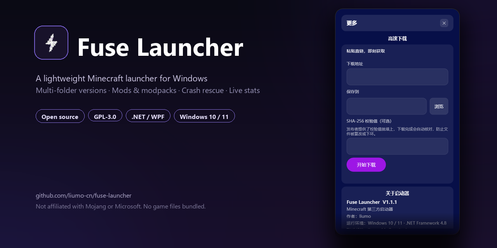

# Fuse Launcher

A lightweight, open-source Minecraft launcher for Windows.

**By liumo** · GPL-3.0 · Windows 10 / 11 · .NET Framework 4.8



---

## Features

**Versions & instances**
- Multiple game folders in one list; add an existing folder or scan the machine in one click.
- Per-instance isolation, with backups, restore, clone and rollback.
- Export an instance to a zip and import it back; import `.mrpack` and plain archive modpacks.
- In-place modpack upgrade with automatic backup and rollback.

**Content**
- Browse and install mods, modpacks, shaders and resource packs from Modrinth.
- Loader-aware filtering (Fabric / Forge / NeoForge / Quilt) and dependency resolution.
- Enable/disable mods, check for updates, bulk update.
- Shader prerequisites (Iris + Sodium, Oculus + Embeddium) installed in one click.
- Local management for mods, worlds, screenshots and the server list (with auto-join).

**Downloads**
- Chunked multi-connection downloads with resume, per-task pause/retry/delete.
- Fast download: any direct URL, optional SHA-256, pre-flight check that rejects HTML pages.
- Automatic mirror selection for game files and Maven artifacts.

**Launching & diagnostics**
- Per-version Java selection with validation (including server JVM checks).
- Custom JVM arguments, memory advisor, process priority.
- Crash rescue: parse the crash report, disable suspect mods, verify and repair files.
- Playtime statistics (local only).
- Live stats overlay: FPS / GPU / CPU / RAM / network / ping, draggable and position-aware.
- Portable mode, log viewer, self-update with checksum verification.

## Requirements

- Windows 10 or 11 (x64)
- [.NET Framework 4.8](https://dotnet.microsoft.com/download/dotnet-framework/net48) to run
- [.NET 8 SDK](https://dotnet.microsoft.com/download/dotnet/8.0) and the .NET Framework 4.8 Developer Pack to build

## Build

```powershell
dotnet build Fuse.sln -c Release
dotnet test src/Fuse.Core.Tests/Fuse.Core.Tests.csproj -c Release
```

Create the installer:

```powershell
powershell -File src/FuseSetup/build-installer.ps1
```

Output: `dist/FuseLauncher-Setup-<version>.exe`.

## Project layout

```
src/Fuse.App          WPF UI (net48)
src/Fuse.Core         Download, install, launch, config (netstandard2.0)
src/Fuse.Core.Tests   Unit tests (net8.0)
src/FuseSetup         Installer
src/FuseUninstaller   Uninstaller
web/                  Download page
tools/                Release and manifest scripts
docs/                 Architecture, changelog, release docs
```

## Privacy

- No telemetry, no analytics, no accounts on our side.
- Microsoft/offline credentials are stored locally and encrypted with Windows DPAPI.
- Playtime statistics and download history stay on the local machine.
- Network access happens only for the actions you take (browsing, downloading, updating).

## License

[GNU General Public License v3.0](LICENSE). Third-party components are listed in
[THIRD-PARTY-NOTICES.txt](THIRD-PARTY-NOTICES.txt).

### Trademark

The **Fuse Launcher** name, the Fuse logo and the official app icons are **not**
covered by the GPL. They may not be used for modified or redistributed builds
(forked releases, repackaged installers, bundled distributions) without prior
written permission. Forks are welcome under the terms of the GPL, but they must
use their own name and visual identity. The official update manifest and
release infrastructure are likewise not part of the licensed source.

## Disclaimer

Fuse Launcher is not affiliated with, endorsed by, or associated with Mojang
Synergies AB or Microsoft. Minecraft is a trademark of Mojang Synergies AB.
This project ships no game files or assets; everything is downloaded from
official or public sources at runtime.

---

# Fuse Launcher（中文）

轻量、开源的 Windows Minecraft 启动器。

## 功能

- **版本与实例**：多游戏目录、一键添加本机目录、实例隔离、备份/还原/复制/回滚、导出导入、整合包原地升级。
- **内容**：Modrinth 模组/整合包/光影/材质浏览与安装、加载器过滤、依赖解析、模组启停与更新、光影前置一键安装、本地模组/存档/截图/服务器管理。
- **下载**：多线程分块 + 断点续传、任务暂停/重试/删除、任意直链高速下载（可选 SHA-256、HTML 拦截）、自动镜像选择。
- **启动与诊断**：按版本选 Java 并校验、自定义 JVM 参数、内存建议、进程优先级、崩溃救援、游玩统计、数据浮窗（FPS/GPU/CPU/内存/网速/延迟）、便携模式、日志查看、带校验的自更新。

## 构建

```powershell
dotnet build Fuse.sln -c Release
dotnet test src/Fuse.Core.Tests/Fuse.Core.Tests.csproj -c Release
powershell -File src/FuseSetup/build-installer.ps1
```

需要 .NET Framework 4.8 Developer Pack 与 .NET 8 SDK。

## 许可

GPL-3.0，第三方组件见 [THIRD-PARTY-NOTICES.txt](THIRD-PARTY-NOTICES.txt)。

### 商标

**Fuse Launcher 名称、Fuse 图标及应用图标不随 GPL 授权**。未经书面许可，
不得用于修改后的版本或再分发的构建（包括 fork 发布、重新打包的安装器、捆绑分发）。
欢迎在 GPL 条款下 fork，但必须改用你自己的名称与视觉标识。官方更新清单与发布设施
同样不包含在授权范围内。

## 声明

本项目与 Mojang / Microsoft 无关联，不分发任何游戏文件；游戏内容在运行时从官方或公共源下载。
